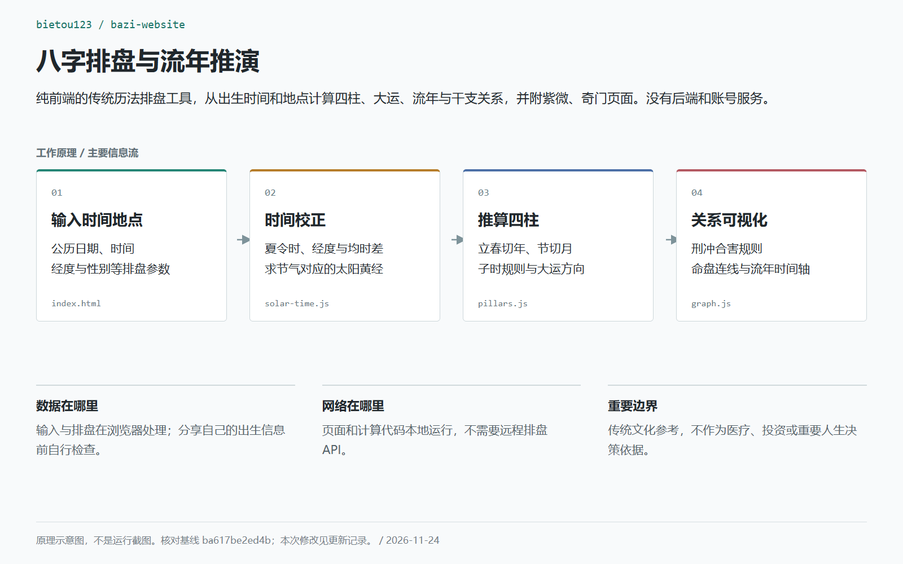

# 八字排盘与流年推演

纯前端的传统历法排盘工具，从出生时间和地点计算四柱、大运、流年与干支关系，并附紫微、奇门页面。没有后端和账号服务。

**适合谁：** 研究传统历法规则、核对排盘边界，或学习天文时间与可视化分层实现的读者。

## 一图看懂



上图是依据公开源码绘制的原理示意，不是运行截图；以下表格与文字提供相同信息，便于小屏阅读。

## 主链路与源码

| 步骤 | 做了什么 | 代码或说明入口 |
| --- | --- | --- |
| 1. 输入时间地点 | 公历日期、时间；经度与性别等排盘参数 | [index.html](../index.html) |
| 2. 时间校正 | 夏令时、经度与均时差；求节气对应的太阳黄经 | [js/astro/solar-time.js](../js/astro/solar-time.js) |
| 3. 推算四柱 | 立春切年、节切月；子时规则与大运方向 | [js/bazi/pillars.js](../js/bazi/pillars.js) |
| 4. 关系可视化 | 刑冲合害规则；命盘连线与流年时间轴 | [js/ui/graph.js](../js/ui/graph.js) |

## 关键原理

### 先统一时间，再排盘

输入的民用时刻先进入儒略日与时间校正模块。真太阳时通过经度修正和均时差求得，历史夏令时单独处理。节气求解使用太阳视黄经，而不是拿固定公历日期切换年柱或月柱。

对应入口：[js/astro/solar-terms.js](../js/astro/solar-terms.js)。

### 算法层不负责画界面

四柱、大运和关系规则分别实现；图表与时间轴读取它们的输出。要核对立春、交节、晚子时等边界，应该先看计算层与测试，再看界面的连线结果。

对应入口：[js/bazi/dayun.js](../js/bazi/dayun.js)。

### 排盘规则与现实预测不同

关系引擎按所采用流派的规则和优先级组合干支。天文计算、传统规则与解释文案是不同层次；程序能够复现规则，不意味着命理判断具备科学预测效力。

对应入口：[js/bazi/relations.js](../js/bazi/relations.js)。

## 数据与安全边界

| 范围 | 说明 |
| --- | --- |
| 数据 | 输入与排盘在浏览器处理；分享自己的出生信息前自行检查。 |
| 网络 | 页面和计算代码本地运行，不需要远程排盘 API。 |
| 重要边界 | 传统文化参考，不作为医疗、投资或重要人生决策依据。 |

## 运行与复现

直接打开 index.html；也可在仓库根目录运行 python -m http.server 8000。

在满足主 README 的依赖与前置条件后，可使用这些现有验证入口：

```text
node test-node.js
```

命令是复现入口，不代表本次重跑了所有历史测试；本轮实测范围见更新说明。

## 已知限制

- 真太阳时、子时归属和合冲优先级存在流派选择，需核对本项目的具体取法。
- 天文近似的适用年代与精度应通过基准样例核验，不能无限外推。

## 本次更新

2026-11-24：新增项目专属原理图、源码入口、运行条件与边界说明。本项目本轮没有修改功能，也没有扩大既有实测结论。

## 可编辑流程图

下面的 Mermaid 与上方 PNG 表达同一主链路，便于后续维护：


[返回项目 README](../README.md)

源码核对基线：[ba617be2ed4b](https://github.com/bietou123/bazi-website/tree/ba617be2ed4b86d9a7d79bdcfb9e7cbd17255c7c)，并结合本次更新中列明的改动。
